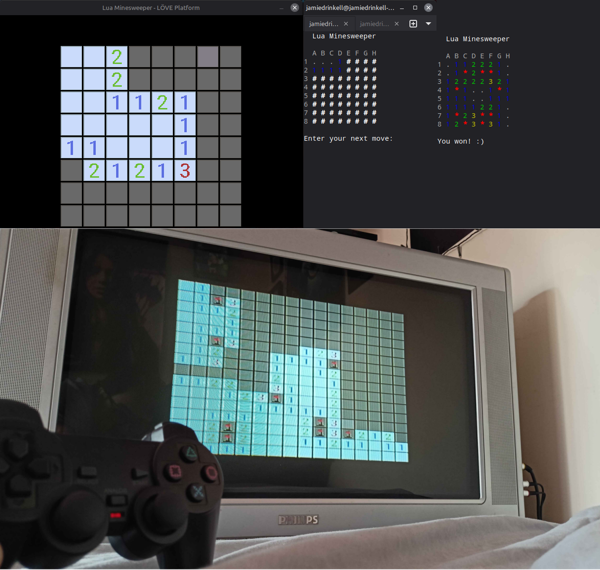

# Lua Minesweeper

This is my attempt at using Lua to make the classic game Minesweeper for as many platforms as I can.
For now it only implements the basic gameplay for with traditional difficulty levels without any timers/flag counters.
It is a work in progress!

## Supported Platforms

- Plain Lua via CLI
- Desktop via LÖVE
- PlayStation 2 via Enceladus

## Game Design

The core logic of Lua Minesweeper is platform independent and implemented in *logic.lua*.

Each platform has a folder within the source tree, which contains platform specific Lua code.
For the most part that is just requiring the logic file and implementing a UI around it.

## Building

There is a Makefile which creates ready to run bundles for each platform under *build/*.
Each platform's build will contain a Markdown file of that platform's name with usage details
(this is created using LDoc, so you will need that installed).
You can build just for a specific platform by specifying the target, e.g. `make lua`.

> [!NOTE]
> Some platforms need to pull files from the web, an internet connection is required to build!

## License

This project has dependencies (e.g. Enceladus) that are GPLv3 and is hence under the same license.
Some files are fetched externally and have their own licenses, but each one is GPL compatible.

## Platforms awaiting implementation and/or under consideration:

- Make LÖVE version play nice on mobile.
- A web option. Love.js is broken so need to consider something like Defold, Solar2D, microStudio etc.
- Dreamcast via ANTIRUINS
- Wii via LuafWii or Wiilove
- MegaDrive via mdlua
- PSP via Lua Player Plus PSP
- If I'm willing to look at developing my own LuaPlayer(s), I could maybe support Gamecube, PS1, N64 etc.
- ROBLOX (as a method to target PS4/5 etc.)
- Textadept
- REAPER

## Credits

- Libraries and dependencies are thanked in the usage documentation for each platform :)
